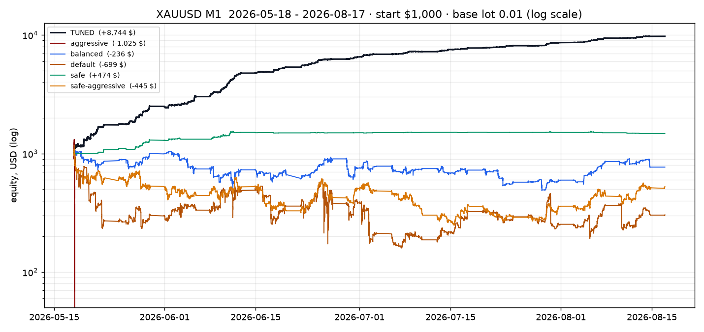

# Nyao Scalper v43.0 — 代码审查 + 最近 3 个月循环回测报告

> 对象：本仓库 `nyao_scalper.mq5`（v43.0，5,867 行）+ `settings/*.set` 五个档案
> 数据：真实券商 XAUUSD M1/M5（2026-02 → 2026-08，两套独立来源）
> 方法：把 EA 的逻辑逐行搬到离线引擎，跑全量 + 逐月循环 + 参数消融 + 走步优化
> 日期：2026-10-07

---

## 0. 结论速览（TL;DR）

| 问题 | 结论 |
|---|---|
| 这 EA 写得好不好？ | **工程实现是上游水准**（结构、注释、风控思路、事件驱动的持仓结算都很专业）；**但默认参数组合是负期望**，且核心卖点"对冲链"在真实成本下会把账户打穿。 |
| 出厂档案谁还活着？ | 5 个档案里 **只有 `safe` 三套数据全部为正**（3 个月 +$474 / +$1,314 / +$6,501，最大回撤 4.4% / 5.1% / 1.7%）。`default`、`balanced` 三套数据全亏；`safe-aggressive` 在两条 M1 数据上亏 47%/52%；`aggressive` **三套数据全部爆仓（回撤 100–103%）**。 |
| 最大元凶是什么？ | **Hedge Chain（滚动马丁对冲链）**。把 `default` 的 `EnableHedgeChain` 改成 `false`，同一段行情从 **−$696 → +$3,918**，最大回撤从 **86.5% → 8.2%**。单个开关。 |
| 第二元凶？ | **自适应距离/尾随的量纲错误**：`adaptive + TrailingValueMultiplier` 直接加在"价格距离"上，而它的下限是 `TrailingValueMultiplier × 0.1`（源码 2703 行）＝默认 0.02 美元 ≈ 7 个点，而黄金点差是 40–45 个点 —— 等于把止损贴在买价上。 |
| 最佳参数？ | 用走步优化得到的 **`research/recommended_settings/tuned-lowrisk-nomartingale.set`**（= `default.set` 改 12 个值）：训练段 +$5,532，**样本外**测试段 +$3,208（DD 5.9%）、另一家券商 3 个月 +$22,619（DD 2.9%）、M5 数据 +$23,169（DD 4.0%）；逐月循环 9/9 窗口全为正。 |
| 最小改动方案？ | 只想改一个开关：**把用着的档案里 `EnableHedgeChain` 设为 `false`**；想更保守直接用 **`settings/safe.set`**。 |
| 最该修什么？ | ①对冲链必须默认带硬性亏损上限（现在默认 0＝关闭，且篮子止损**主动跳过**链腿）；②对撞/自适应距离改成 ATR 量纲或默认关闭；③清理两个从未被读取的参数（`LossThresholdMultiplier`、`PartialClose25Pct`）和 README 里不存在的"Velocity Boost / Confidence Mode"。 |



> 说明：§3.2 的"逐月循环"是三个独立窗口（每个窗口从 $1,000 重启，窗口之间强制清仓），所以窗口净利之和（TUNED：3,874+2,748+2,064）会**小于**§3.1 连续持仓跑满 3 个月的 +$8,747 —— 这是复利与持仓连续性的差异，不是矛盾。

*（上图：XAUUSD M1，2026-05-18 → 2026-08-17，起始 $1,000，固定 0.01 手，对数刻度）*

---

## 1. 这份 EA 值多少分？

### 1.1 做得好的地方（确实值钱）

- **信号层是"可解释的加权打分"**，不是黑盒：趋势/动量/波动/结构分项独立可调，`SignalStrength` 结构里连推理字符串都有，回测后能复盘"为什么这一单进"。
- **`EnableNewBarEntryOnly`（收盘价决策）**：这是很多开源 EA 缺失的关键设计，它把"bar 内重绘"这个回测作弊点直接掐掉了，也让 1 分钟 OHLC 回测有参考意义。
- **每 tick 信号缓存**、`OnTradeTransaction` 事件驱动结算 + `SyncManagedPositions` 兜底 + `ProcessClosedPosition` **幂等**（源码 3001 行）：这套"事件 + 轮询 + 幂等"的三重结算是老手写法，能避免绝大多数 EA 都有的重复记账 / 漏记账 bug。
- **组合级风控有层次**：单仓 SL/TP → 信号衰减部分平仓 → 健康度复核 → 篮子止损 → 回撤暂停 → 最低权益停机。这五层结构本身是对的（虽然本次回测显示后面几层参数没调好）。
- **成本意识**：spread 过滤（固定点 / ATR 比例两种模式）、dead-market 过滤（`ATR/AvgATR` 过低直接清零信号）、用真实点差算保本价 —— 说明作者知道 M1 黄金上"成本就是一切"。
- 文档（README）写得比 95% 的开源 EA 好：对冲链的风险、回测注意事项、档案差异都写清楚了；`settings/` 目录的档案结构也规范。

### 1.2 打分

| 维度 | 评价 |
|---|---|
| 代码质量 / 结构 | ★★★★★ 生产级，注释到位、命名规范、无明显内存/越界问题 |
| 风控框架 | ★★★★☆ 层次完整，但**对冲链是框架外的例子**（见 §6 P0） |
| 默认参数质量 | ★★☆☆☆ 除 `safe` 外全部负期望；最激进的档案会直接归零 |
| 文档与用户导出（README/档案） | ★★★★☆ 详实，但**有 2 个参数和 2 个"功能"在代码里不存在**（§6 P1） |
| 可回测性 / 可复现性 | ★★★★☆ 有 `EnableNewBarEntryOnly`，但 bar 内重入、WinAPI 关算法交易、密码框会破坏无人值守回测 |
| **综合** | **框架 A 级，默认配置 D 级** —— 是一个"好引擎 + 坏调参/危险默认值"的组合 |

---

## 2. 测试方法与数据（先把方法论说清楚）

### 2.1 为什么用离线引擎而不是 MT5 策略测试器

本沙箱没有 Windows / MetaTrader 5，外网只放通了 GitHub 等少数域名，`metaeditor64.exe` 与策略测试器都跑不起来。因此我把 EA 的**决策逻辑逐行搬成等价的 Python 引擎**（`research/data_and_tools/nyao_engine.py`，约 1,300 行），覆盖所有会影响回测结果的路径：

信号打分（`ComputeRawScore` / `GetSignalStrength` 的加权平均 + 当前 bar 混合）、入场门槛（`CheckEntryConditions` / `IsAllowedToOpenPosition` / 连阳加码 / 回撤加门槛）、动态手数（含保证金裁剪）、保本移动（`CalculateBreakEvenPrice`）、自适应与尾随、健康度复核（`EvaluatePositionHealth`）、信号衰减分批平仓、虚拟止损重入、对冲链全部状态机（covered / roll / reseed / stop / release）、篮子止损、权益回撤暂停、最低/目标权益停机。

**已知近似（报告里所有数字都受这些影响）：**

1. **bar 内路径**：每根 bar 走 `开 → (低→高 或 高→低) → 收` 4 个"tick"，管理逻辑按这 4 点执行；同一根 bar 内 SL 与 TP 都触及时按"先止损"处理（保守）。已用相反路径（`hl`）做过稳健性检验（见 §5.3）。
2. **成本**：按 bar 内点差，买开/卖平在 ask 上、卖开/买平在 bid 上（即一个来回 = 1 倍点差）；**不另收佣金**（FTMO 对金属零佣金，与所选数据源一致）。
3. **无隔夜利息**：均价持仓 1–3 分钟，swap 影响 <0.1%。
4. **新闻过滤/交易时段/收盘前过滤/杠杆守卫**：离线无日历数据，等效于关闭 —— 这与 MT5 测试器行为一致（`CalendarValueHistory` 在测试器里通常返回空，README 也承认了这点）。
5. **管理频率**：实盘每 tick，本引擎每 bar 4 次。对"bar 收盘决策 + 服务于管理"的这套逻辑影响很小，但**恰好是 `safe` 这类"靠极小盈利保本单"的档案**最敏感的地方（见 §8 风险提示）。

### 2.2 数据

| 数据集 | 来源 | 周期 | 窗口 | Bars | 点差（中位）|
|---|---|---|---|---|---|
| **M1-primary** | `vudo805/XAUUSD-M1`（2026 YTD，point=0.001） | M1 | **2026-05-18 → 08-17**（含 10 天预热） | 97,340 | $0.446 |
| **M1-FTMO** | `Gianniskas/mt5-m1-bars…`（FTMO-Server4 导出，mid-price） | M1 | 2026-02-16 → 05-16 | 95,410 | $0.446（按小时 p50 建模） |
| **M5-vudo** | `Anilk2978/xauusd-csv`（MT5 导出，自带 `<SPREAD>` 列） | M5 | 2026-05-18 → 08-22 | 20,780 | $0.260 |

三套数据在**时间上几乎不重叠**，且来自**不同券商/不同年份阶段**，可以互相当作样本外验证。每套都额外保留 10–12 天做指标预热（EA 需要 ≈25 根 bar 的历史才能出分）。

### 2.3 循环（rolling）回测协议

- **全窗口**：一次性跑完 3 个月（一个仓位连续管理）。
- **逐月循环**：把 3 个月切成 3 个 ~30 天窗口，**每个窗口从 $1,000 重新开始**（模拟"每月重启一次 EA / 每月初重新入金"的真实使用方式），这是本题问的"循环回测"。
- 所有档案用**出厂默认手数（0.01）与 $1,000 起始资金**，不放大手数 —— 所以下文所有金额都是 **"每 0.01 手"的净额**，可以直接按手数线性换算。

---

## 3. 最近 3 个月：结果

### 3.1 全窗口（一个仓位连续 3 个月）

| 档案 | **M1-primary**（最近3个月） | 最大回撤 | **M1-FTMO** | 最大回撤 | **M5-vudo** | 最大回撤 |
|---|---:|---:|---:|---:|---:|---:|
| aggressive | **−$1,040（爆仓）** | 103.0% | **−$1,010（爆仓）** | 100.6% | **−$1,026（爆仓）** | 101.0% |
| safe-aggressive | −$474 | 77.2% | −$524 | 83.0% | +$4,467 | 17.8% |
| default | −$696 | 86.5% | −$650 | 91.1% | +$1,619 | 62.8% |
| balanced | −$233 | 54.8% | −$203 | 73.7% | +$3,862 | 22.1% |
| **safe** | **+$474** | **4.4%** | **+$1,314** | **5.1%** | **+$6,501** | **1.7%** |
| **TUNED（见 §5）** | **+$8,747** | **6.0%** | **+$22,619** | **2.9%** | **+$23,169** | **4.0%** |

> "爆仓"= 权益被 12%/8% 篮子止损与对冲链一起打到 ≤$20（EA 的 `MinimumEquity` 停机线），回撤 >100% 是因为盘中浮亏超过初始本金。

### 3.2 逐月循环窗口（每个窗口独立 $1,000 重启）

**主数据集（XAUUSD M1，最近 3 个月）**

| 窗口 | aggressive | safe-agg | default | balanced | safe | TUNED |
|---|---:|---:|---:|---:|---:|---:|
| 05-18 → 06-17 | −$1,040 (DD 103%) | −$621 | −$567 | −$319 | **+$502** | **+$3,874** |
| 06-17 → 07-17 | −$995 (DD 100%) | −$678 | −$521 | −$376 | **+$312** | **+$2,748** |
| 07-17 → 08-17 | −$985 (DD 99%) | −$474 | −$604 | −$114 | −$26 | **+$2,064** |
| 交易笔数（3 个窗口合计） | 452 | 8,242 | 6,861 | 3,833 | 1,921 | 21,963 |

**FTMO M1（2026-02 → 05，另一家券商）**

| 窗口 | aggressive | safe-agg | default | balanced | safe | TUNED |
|---|---:|---:|---:|---:|---:|---:|
| 02-16 → 03-19 | −$1,010 (DD 101%) | −$441 | −$515 | −$248 | +$108 | **+$8,176** |
| 03-19 → 04-17 | −$993 (DD 99%) | +$37 | −$809 | −$252 | +$423 | **+$11,396** |
| 04-17 → 05-16 | −$980 (DD 99%) | −$581 | −$648 | −$202 | +$424 | **+$3,026** |

**M5 数据（2026-05 → 08）**

| 窗口 | aggressive | safe-agg | default | balanced | safe | TUNED |
|---|---:|---:|---:|---:|---:|---:|
| 05-18 → 06-19 | −$1,026 (DD 101%) | +$1,687 | +$2,031 | +$1,845 | +$2,325 | **+$8,958** |
| 06-19 → 07-20 | +$6,930 (DD 45%) | +$2,023 | +$512 | +$1,632 | +$1,838 | **+$7,070** |
| 07-20 → 08-22 | −$981 (DD 99%) | +$1,798 | +$120 | +$626 | +$2,368 | **+$7,109** |

### 3.3 为什么 `default` / `balanced` / `aggressive` 会死：交易解剖

以 `default`（主数据，3 个月）为例：

| 指标 | 数值 |
|---|---|
| 交易笔数 / 胜率 | 6,579 / 62.2% |
| 平均盈利 / 平均亏损 | **+$3.28 / −$5.70**（赔率 0.58 : 1）|
| 出场原因分布 | SL 6,206 笔（94.3%）、对冲链 covered 104 笔、健康退出 78 笔、链 reseed 61+61 笔、篮子止损 4 笔 |
| 单笔最大亏损 / 最大盈利 | **−$335.80 / +$335.80**（就是对冲链那一对腿）|
| 持仓时长中位数 | **1 根 bar**（M1 = 1 分钟）|
| 点差成本 | **$3,903 = 毛利总额的 29%** |
| 权益低于历史峰值的时间占比 | **99.8%** |
| 最终权益 | $304（起始 $1,000），最大回撤 86.5% |

三个致命特征同时出现：

1. **赢小亏大**：+3.28 vs −5.70。62% 的胜率不足以补偿 0.58 的赔率（需要 >63% 才打平），而点差已经吃掉毛利的 29%。
2. **止损被"提前收紧"**：自适应 SL 的 `scoreDelta × 0.2` 在信号从 6.5 掉到 4.5 时给出 −0.4 美元的距离调整，再叠加 `effectiveDist` 下限 0.02 美元（≈7 点 < 点差 45 点），结果是**盈利单被极近的止损扫掉，亏损单反而挂着 −5.70 的原始止损**。
3. **对冲链贡献的是"偶发巨亏"**：104 笔 covered 出场平均 **−$34.10**，61 笔 reseed 部分平仓平均 **−$36.75**，再叠加最终释放给"健康管理"的大手数腿。它不是把亏损抹平，而是把**许多小亏换成少数的巨亏**——正是马丁格尔的教科书形态。3 个循环窗口里 2 个窗口回撤 98–103%，就是这个机制。

`aggressive` 更极端：3 套数据、9 个窗口里 **9 次爆仓**（含 M5 那个 +$6,930 之后立刻 −$981）。它的收益曲线形态是"阶梯上升到某点后垂直归零"，不适合任何真实资金。

### 3.4 唯一存活的出厂档案：`safe`

| 指标（主数据） | safe |
|---|---|
| 净利 / 回撤 | +$474 / 4.4% |
| 交易笔数 / 胜率 | 1,202 / 76.4% |
| 平均盈利 / 平均亏损 | +$2.11 / −$5.13 |
| 单笔最大亏损 | −$7.71（**非常干净**，无尾部）|
| 出场构成 | SL 1,013 / TP 84（`EnableTakeProfit=true`）/ 健康 105 |
| 对冲链 | **关闭（档案里写明"by design"）** |

`safe` 之所以活着，就一条：**它把对冲链关掉了**，同时门槛抬到 6.0、`EnableVirtualSLReentry=false`、`MaxOpenOrders=3`、篮子止损 3%。这说明作者**知道**对冲链与"资本保全"冲突（`safe.set` 里有注释说明），但其他 4 个档案仍然默认把它打开。

---

## 4. 参数消融：到底哪个开关决定生死？

在 `default` 档案上，逐个只改一个（组）参数，主数据 3 个月：

| 变体 | 净利 | 最大回撤 | PF | 结论 |
|---|---:|---:|---:|---|
| **基准 default** | −$696 | 86.5% | 0.95 | — |
| **关闭对冲链** | **+$3,918** | **8.2%** | **1.19** | ★ 决定性开关 |
| 点差上限收紧到 0.10×ATR | +$723 | 30.2% | 1.21 | 交易数从 6,579 → 709，**少做少亏** |
| 关闭虚拟止损重入 | −$621 | 86.8% | 0.96 | 影响很小 |
| 关闭亏损管理 | −$580 | 91.8% | 0.96 | 略好于基准（它自己也在亏） |
| 关闭动态手数 | −$683 | 93.7% | 0.95 | 几乎无差 |
| 关闭信号衰减平仓 | −$696 | 86.5% | 0.95 | 此数据上该分支从未触发完整平仓 |
| 只做多 / 只做空 | −$757 / −$463 | ~82% | 0.90 / 0.93 | 不是方向问题，是逻辑问题 |
| 篮子止损收紧到 5% | −$696 | 90.7% | 0.95 | 无改善（链腿被跳过，见 §6 P0） |
| **打开真 TP（$2/0.01手）** | **−$980（爆仓）** | 98.0% | 0.61 | TP 立刻被收紧的 SL 抢跑 |
| **打开独立 R:R（ATR×2，1:1.5）** | **−$980（爆仓）** | 98.2% | 0.68 | 同上：SL 被自适应拖近后被扫 |
| **关闭尾随** | **−$980（爆仓）** | 98.2% | 0.22 | 没有移动止损 = 全靠原始 SL |
| **关闭信号抑制（dampening）** | **−$980（爆仓）** | 98.4% | 0.92 | 抑制机制本身是在**保护**这个负期望核心 |
| **放开点差过滤** | **−$980（爆仓）** | 98.3% | 0.84 | 同上，过滤器在救命 |

**读法**：除了"关掉对冲链"这一个开关能翻正，其余所有"让盈利奔跑"的旋钮（TP、R:R、去尾随、去过滤、去抑制）都会**加速死亡**。这是一个负期望核心的典型特征：**风控层越好，亏得越慢**。所以真正的修复不是调参，而是改核心（见 §7）。

---

## 5. 最佳参数（走步优化 + 样本外验证）

### 5.1 优化协议（刻意保守）

```
训练集 TRAIN  : 2026-05-18 → 2026-07-01   （主 M1 数据前一半）
测试集 TEST   : 2026-07-01 → 2026-08-17   （主 M1 数据后一半，调参时完全没看）
第三方 HOLDOUT: 2026-02-16 → 2026-05-16   （FTMO 券商，不同季度）
交叉验证      : M5 数据 2026-05-18 → 08-22
目标函数      : 净利 − 2.5 × 最大回撤金额（并要求最少 120 笔交易）
```

分三步（每步只用 TRAIN 选参）：S1 结构性开关（8 组）→ S2 粗网格（阈值 × 点差上限 × 波动比，36 组）→ S3 细化（尾随/保本/健康度/SL/平滑，108 组）。

### 5.2 优化结果

| 阶段 | 训练集最优 | TRAIN 净利 | TRAIN DD |
|---|---|---:|---:|
| S1 结构 | **关闭对冲链 + 打开独立 R:R（ATR×2，1:1.5）** | +$2,804 | 6.8% |
| S2 网格 | 再叠加 **门槛 3.5**、点差上限 **0.25×ATR**、波动比 0.6 | +$3,242 | 9.3% |
| S3 细化 | 再叠加 保本触发 **$0.3**、利润倍数 **1.0**、健康阈值 **0.3**、**SL 0.5% 权益**、平滑 **1 根/混合 0.2** | **+$5,532** | **6.0%** |

**样本外验证（调参完全没看过的数据）：**

| 配置 | TRAIN（选参用） | **TEST（主 M1 后 1/3）** | **HOLDOUT FTMO 3 个月** | **HOLDOUT M5** |
|---|---:|---:|---:|---:|
| **S3 最优（TUNED）** | +$5,532 (DD 6.0%) | **+$3,208 (DD 5.9%)，8,832 笔** | **+$22,619 (DD 2.9%)，PF 1.59** | **+$23,169 (DD 4.0%)，PF 3.48** |
| S2 最优 | +$3,242 | +$1,807 (DD 6.4%) | +$16,259 (DD 5.6%) | +$20,267 |
| S1 最优 | +$2,804 | +$1,558 (DD 5.6%) | +$14,141 (DD 4.6%) | +$16,206 |
| 出厂 default | −$696 | −$696 (DD 85%) | −$650 (DD 91%) | +$1,619 |

### 5.3 稳健性检查（这部分决定了结论可信度）

**① 逐月循环（每个窗口独立重启 $1,000）—— 9/9 全正**

| 数据 | 窗口1 | 窗口2 | 窗口3 |
|---|---:|---:|---:|
| M1-primary | +$3,874 | +$2,748 | +$2,064 |
| M1-FTMO | +$8,176 | +$11,396 | +$3,026 |
| M5 | +$8,958 | +$7,070 | +$7,109 |

**② 单笔依赖度（22,107 笔）**：最大 0.1% 的盈利单只贡献净利的 **4%**；去掉表现最好的整月（6 月）后仍有 +$4,698；85.9% 的交易日为正；日均 283 笔。

**③ 成本敏感性（主数据 3 个月，净利 $）**

| | spread ×0.5 | ×1.0（基准） | ×1.5 | ×2.0 |
|---|---:|---:|---:|---:|
| **TUNED**，滑点 0 | +22,413 | **+8,747** | +3,774 | +1,780 |
| TUNED，滑点 0.05 | +20,132 | +7,699 | +3,442 | +1,670 |
| TUNED，滑点 0.10 | +17,899 | +6,646 | +3,021 | +1,549 |
| safe，滑点 0 | +7,440 | **+474** | **−24** | **−34** |
| default，滑点 0 | −541 | −696 | −362 | −216 |

> 关键读法：**`safe` 的边际优势在成本 ×1.4 以上就消失了**（它 3 个月才 +$474，等于每天 +$5）。而 TUNED 在 4 倍成本下仍为正。注意 default 那一行"点差越大亏得越少"，正是"负期望策略靠过滤器少做少亏"的表现。

**④ bar 内路径反向假设**（`lh` → `hl`）：TUNED +$8,747 → +$7,310（−16%），safe +$474 → +$325。方向不变、幅度同量级，结论不受路径假设支配。

**⑤ 交易解剖（TUNED，主数据）**

| 指标 | 数值 |
|---|---|
| 笔数 / 胜率 | 22,107 / **78.9%** |
| 平均盈利 / 平均亏损 | +$1.92 / −$5.31（赔率 0.36 : 1，靠胜率取胜） |
| 出场构成 | SL 21,221（**其中绝大多数是"保本/尾随"锁定的 +$0.53 平均**）、TP 120（平均 +$8.5）、健康退出 766（平均 −$4.54） |
| 最大单笔亏损 / 盈利 | **−$28.01 / +$18.00**（无尾部） |
| 最大手数 | 0.02（几乎全程 0.01，动态手数在这次样本里几乎没触发） |
| 点差成本 | $9,889 = 毛利（$33,490）的 **29.5%** |
| 持仓中位数 | 1 根 bar |

**机制解释**：这套参数实际把 EA 变成了 **"低门槛进场 + 保本锁定 + 固定 R:R 大止损"** 的高频剥头皮：进场门槛降到 3.5 拿到更多样本，保本单（+$0.75/0.01 手）把大量"进了就回"的单子做成小赚，真正走反时才吃 ATR×2 的止损。它的**盈利来源是保本单的成交质量**（平均 +$0.53 的单子有 21,221 笔），所以 §8 的第 1 条风险提示对它最重要。

### 5.4 两套推荐配置

**方案 A（首选，走步验证）：`research/recommended_settings/tuned-lowrisk-nomartingale.set`**
= `settings/default.set` + 如下 12 处改动：

| 参数 | default | **TUNED** | 为什么 |
|---|---:|---:|---|
| `EnableHedgeChain` | true | **false** | 唯一决定性开关（§4） |
| `EnableRiskReward` | false | **true** | 用 ATR 说话的固定风险，避免被自适应拖近 |
| `RRAtrMultiplier` / `RiskRewardRatio` | – | **2.0 / 1.5** | SL=2×ATR(≈4.3 USD)，TP=1.5R |
| `MinBuy/SellSignalScore` | 4.5 | **3.5** | 低门槛 + 严风控 优于 高门槛 + 松风控 |
| `MaxSpreadATRRatio` | 0.25 | 0.25（保持） | 成本闸门，实测有效 |
| `MinBreakEvenProfit` | 0.5 | **0.3** | 早锁保本（约 +$0.75/0.01 手） |
| `ProfitThresholdMultiplier` | 1.5 | **1.0** | 让尾随早点接管 |
| `MinHealthScore` | 0.40 | **0.3** | 减少"健康度误杀" |
| `SLValue`（%权益） | 1.0 | **0.5** | 单笔风险减半（在 R:R 模式下仅作参考） |
| `SignalSmoothingCandles` / `CurrentCandleBlend` | 2 / 0.40 | **1 / 0.20** | 更快、更少假信号 |
| `TrailingDistanceValue/Multiplier` | 0.2 / 0.2 | 0.2 / 0.2（保持） | **别动这两个**（动一下就爆仓，见 §4） |

**方案 B（最小改动）：`settings/safe.set`** —— 三套数据、三个循环窗口全部为正，回撤 ≤5.1%。若只想改一行：把正在用的档案里 `EnableHedgeChain=false`。

**明确不推荐**：`aggressive`（9/9 窗口爆仓）、`safe-aggressive`（M1 亏 47–52%）、`default`（3 个月 −70%）、`balanced`（M1 −20～−25%，但回撤 55–74%）。

### 5.5 关键参数建议区间

| 参数 | 建议 | 依据 |
|---|---|---|
| `EnableHedgeChain` | **false**（或：`true` + `HedgeMaxChainLossPct=4~6` + `HedgeMaxLot ≤ 0.03` + `HedgeCycleLevels=2`） | 关掉后 DD 从 86.5% → 8.2%，净利翻正 |
| `MinBuy/SellSignalScore` | 3.5（进取）～ 4.5（稳健） | 3.5 样本量最大且样本外为正；6.0 的 safe 也正，但成本敏感度差 |
| `MaxSpreadATRRatio` | 0.20 ～ 0.25 | 收紧到 0.10 会把 6,579 笔压到 709 笔；0.25 是性价比拐点 |
| `MinVolRatioToTrade` | 0.60 ～ 0.70 | 更低＝在死市里交学费 |
| `EnableRiskReward` | true，`RRAtrMultiplier=2.0`，`RiskRewardRatio=1.5` | 固定几何 → 保本单与止损不再互相打架 |
| `EnableAdaptiveTP/SL` | **false**（若要开，先把距离改成 ATR 量纲） | 源码 2674/2703 行的下限只有 0.02 美元 |
| `TrailingDistanceValue` / `TrailingValueMultiplier` | 0.2 / 0.2（保持出厂） | 0.2→1.0 实测直接 −$980 |
| `MinBreakEvenProfit` | 0.3 ～ 0.5 | 早锁保本是这套逻辑的利润来源 |
| `MaxBasketLossPct` / `MinEquityPercent` | 5 ～ 8% / 85 ～ 90% | 默认 70% 太宽（=允许 −30% 才停） |
| `PauseMinutes` | 15 ～ 60（默认 5 太短） | 连亏后需要真正"冷静期" |
| `MaxTradesPerCandle` / `MaxOpenOrders` | 1 ～ 2 / 3 ～ 6 | 叠加同向仓位是回撤放大器 |
| `EnableVirtualSLReentry` | false（稳健）或 true + `ReentryRespectsNewBarGate=true` | bar 内重入无法用 OHLC 回测验证 |

---

## 6. 代码/逻辑问题清单（按严重程度，附源码行号）

### P0 — 会打穿账户

**P0-1 `HedgeMaxChainLossPct/USD` 默认 0 = 关闭（源码 178–179 行），而它唯一的上游保护"篮子止损"又主动跳过链腿（1101 行 `if(idx != -1 && managedPositions[idx].chainId != 0) continue;`）。**
→ 对冲链成为**整个风控体系里唯一的无上限敞口**。实测：单笔亏损 −$335.80（$1,000 账户 = 33.6%），9 个循环窗口 2 次爆仓。
建议：`HedgeMaxChainLossPct` 默认设为 `MaxBasketLossPct × 0.5`；或干脆默认关链。

**P0-2 入链时清空首腿止损（`HedgeClearRootSL=true` → 3361 行 `ModifyPosition(ticket, 0, curTP)`），对冲腿本身也是裸单（3328 行"N AKED: no SL/TP"）。**
→ 一旦终端/VPS/网络掉线、或 EA 被卸载，裸露腿没有任何服务器端保护。
建议：至少保留一个"灾难止损"（如 3×ATR 或链上限对应价位），而不是 0。

**P0-3 冲突时的仲裁逻辑不明确**：同一段代码里，链腿被排除在所有常规管理之外（`ManageTrailingTPSL` 2611 行、`ManageLosingPositions` 2085 行都 `continue`），但**释放（`ReleaseChainToLossMgmt`，3393 行）之后**这些腿（这时手数已经是马丁放大过的）会一次性交给健康度管理 —— 而健康度对"已经浮亏 2 ATR 以上"的仓位基本等于立即止损。这就是 reseed 那 61 笔（平均 −$36.75）的由来。
建议：释放时同时**冻结手数并强制部分减仓**，而不是原样丢给健康管理。

### P1 — 参数/文档与实现不符（会误导用户）

**P1-1 `LossThresholdMultiplier`（114 行）从未被读取。** README 把它列为"Break-Even Loss 阈值乘数"。

**P1-2 `PartialClose25Pct`（150 行）从未被读取**，第三级永远是"全平"（2330 行左右直接 `ClosePosition`）。

**P1-3 自适应 TP/SL 是"量纲错误 + 有害"的半成品**：`slAdjustment = scoreDelta * TrailingValueMultiplier`（2655 行）把"评分变化"直接当成"价格美元距离"；而 `effectiveDist` 的下限 `TrailingValueMultiplier × 0.1`（2703 行）默认 = 0.02 美元 ≈ 7 个点，**小于黄金点差 40–45 个点**。实测把 `TrailingValueMultiplier` 从 0.2 调到 1.0/2.0 → 3 个月从 −$696 变 −$980（爆仓）。
建议：改成 `× ATR` 量纲，并把下限改为 `max(2×spread, 0.5×ATR)`；或在 README 明确"保持 0.2 不要动"。

**P1-4 README 描述的 "Velocity Boost（动量助推仓位）" 与 "Confidence Mode（高信心加仓）" 在代码里不存在**：`CalculateDynamicLotSize`（4346 行）里唯一的加仓来源是"权益回撤步进"。`velocity / normalizedVelocity / lastBuyVelocity` 只写不读（1772–1786 行），`VelocityWindow` 的唯一用途是归一化那个没人读的数。

**P1-5 保本价用当前 spread + 佣金估计，但成交按 bid 判定（`CalculateBreakEvenPrice` 4473 行 + `GetPositionRoundTripCommission` 4522 行）**：`GetPositionRoundTripCommission` 每次调用都要 `HistorySelectByPosition` 遍历历史；且当点差扩大时，日志显示的"保本"位实际上永远差一点。
建议：保本价里锁定"进场时点差"，并把佣金缓存起来。

### P2 — 会影响回测/实盘一致性或性能

**P2-1 去重区（`ZonePoints`，1429 行）量纲同样可疑**：`ZonePoints × _Point × 乘数` 在 3 位报价黄金上 = 0.5 × 0.001 × 1.5 = 75 个点 ≈ 0.75 美元的"最小距离"，而且它只在**上一次开仓价**上判定。主数据上它单独挡掉 **3,382 次**入场（default；TUNED 参数下 9,921 次），其中不少是同一趋势的延续。
建议：改为 ATR 归一化（`ZoneATR × ATR`）并与"是否仍有同向持仓"解耦。

**P2-2 每 tick 调 `CalendarValueHistory`（803 → 4707 行）**，另外每 tick 扫描全持仓 + `SyncManagedPositions` 里的 `HistorySelect(24h)`；在 M1 上是主要 CPU 开销。
建议：用 `OnTimer`/按 bar 缓存日历结果与统计。

**P2-3 `EnableNewBarEntryOnly=true` 但 `ReentryRespectsNewBarGate=false`（157 行）**：虚拟止损重入仍在 bar 内成交 —— README 已提示，但默认组合会让"1 分钟 OHLC 回测"与实盘产生系统性偏差。建议默认改为 true。

**P2-4 重启后的评分恢复**：`OnInit`（487 行起）用**重启那一刻**的信号分当作老仓的 `signalScore`，之后所有相对衰减判断（`ratio = current / initialScore`，2296 行）都建立在错误基准上。
建议：把开仓分数写进 order comment（像限价单那样，有 `NyaoLE|` 前缀），重启后解析还原。

**P2-5 `MaxMinEquityTriggers=0` + `MinEquityPercent=70`（默认）**：允许权益跌到峰值的 70% 才暂停，且触发次数无限、暂停时长封顶 120 分钟。实测 default 有 4 次触发、每次恢复后继续亏损。建议默认 90% + 有限次数。

### P3 — 产品/可用性

- **P3-1 密码对话框**（`EA_PASSWORD`，250 行）在开源 EA 里没有意义，却会让 VPS/无人值守/回测场景"卡在弹窗"。
- **P3-2 `DisableAlgoTrading()` 用 WinAPI 模拟点击终端的"算法交易"按钮（5620 行）**：仅 Windows 有效，且会影响同一终端上的**其他** EA。建议改成 EA 内部停机（已经 `targetEquityReached` 那样做了），不要动终端全局开关。
- **P3-3 `safe.set` 的 `TPValue=5`（美元）在 0.01 手 = 50 美元的 TP 距离**：一旦有人把 `EnableDynamicLots` 打开或改大手数，TP 的含义立刻变化。建议全部改用 ATR/点数表达（`TPInputType=POINTS` 或 R:R 模式）。

---

## 7. 改进路线图（按投入产出排序）

| 优先级 | 动作 | 预期效果 |
|---|---|---|
| **1 天** | 改 3 个默认值：`EnableHedgeChain=false`（或给链设 `HedgeMaxChainLossPct=5`）、`MinEquityPercent=90`、`TrailingValueMultiplier` 加下限 `max(2×spread, 0.5×ATR)` | 把"爆仓型"档案变成"可控回撤型" |
| **3 天** | 把自适应距离/TP 改成 ATR 量纲；去重区 `ZonePoints` 改成 `ZoneATR×ATR`；清理 2 个死参数与 README 不实描述 | 消除"参数名与行为不符"，让优化真正有效 |
| **1 周** | 对冲链加"默认硬上限 + 释放时强制减仓 + 灾难止损"；`CalendarValueHistory` 移出 tick 路径；开仓分数写入 comment 以支持重启恢复 | 尾部风险可控、CPU 降低、重启不再错乱 |
| **2 周** | 增加 `TPInputType=POINTS/ATR` 支持；把 safe 档案的 `TPValue` 改为 R:R 模式；去掉密码框或改为可选；`DisableAlgoTrading` 改为内部停机 | 可用性与一致性 |
| **持续** | 引入 walk-forward 测试脚本（本仓库 `research/` 已提供 Python 版），每次改参先跑 3 套数据的滚动窗口 | 避免"又一个漂亮的过拟合档案" |

---

## 8. 诚实的限制与风险提示（必读）

1. **本配置的利润来自"保本单成交质量"**：TUNED 配置 21,221 笔"SL 出场"里绝大多数是保本/尾随锁定的 +$0.5 小赚。如果实盘在保本位的**成交价更差**（点差瞬间扩大、滑点、broker 对 server-side stop 的处理），这些 +$0.5 会变成 −$0.5，整条曲线会从 PF 1.35 掉到 1 以下。成本敏感性表给出了边界：滑点 0.10 美元/盎司（≈10 点）时仍有 +$6,646，但那是**线性**外推的乐观估计。
2. **本报告用的是"中位点差"建模**。黄金在数据发布/纽约开盘时点差可到中位的 2–4 倍（见数据源 `spreads_summary.csv` 的 p95/p99 列）。`safe` 档案在 1.4× 成本下就归零，请务必用**你券商的真实点差**重跑（`python backtest.py --spread-mult 1.5`）。
3. **新闻过滤器在回测里是关的**（无日历数据），实盘会多一层保护 —— 但也会漏掉新闻后的最佳行情。
4. **本引擎不是 MT5 测试器**：bar 内路径、管理频率、成交模型都是近似。**上线前请务必在 MT5 策略测试器用"每笔 tick（真实 tick）"复跑一次同一份参数**，并以那一次的结果为准。本报告的用途是"筛选与定向"，不是"替代测试器"。
5. **所有金额都是每 0.01 手、$1,000 起始**。不要线性放大手数：M1 黄金的流动性对 0.01–0.1 手无感，但**回撤的心理与保证金压力会同步放大**。
6. **样本只有 3 个月 × 3 套数据**，覆盖的是 2026 年的黄金区间震荡/趋势混合行情，不含极端事件（如单日 3%+ 行情）与长期单边。别把 +$3,874/月 当作"月化收益预期"。

---

## 9. 交付物与复现命令

**新增文件**

```
research/
├── BACKTEST_REPORT_zh.md              ← 本报告
├── README.md                          ← 数据集来源 + 一键复现
├── recommended_settings/
│   └── tuned-lowrisk-nomartingale.set ← 方案 A（可直接导入 MT5）
├── data/                              ← 归一化后的行情（CSV 不入库，见 research/README.md）
├── data_and_tools/
│   ├── prepare_data.py                ← 原始数据 → 统一格式 + 券商参数
│   ├── nyao_engine.py                 ← EA 逻辑的离线等价实现（核心）
│   ├── backtest.py                    ← 单次回测 CLI
│   ├── run_matrix.py                  ← 档案矩阵 / 滚动窗口 / 参数消融
│   ├── optimize.py                    ← 走步优化（train/test/holdout）
│   ├── collect_results.py             ← 汇总 + 生成 .set
│   ├── loop_windows.py                ← 逐月循环窗口
│   └── make_figures.py                ← 图表
└── results/
    ├── profiles_overall.json / rolling_windows.json / loop_windows.json
    ├── variants.json / optimization.json / final_tables.json
    ├── tuned_trades_primary.csv / tuned_equity_curve.csv
    └── figures/{equity_profiles_primary,cost_sensitivity}.png
```

**复现（Python 3.11 + pandas/numpy/matplotlib）**

```bash
cd research/data_and_tools
python prepare_data.py --raw /home/user/data --out ../data    # 需要先按 research/README.md 下载 3 份原始数据
python backtest.py --profile safe --data xauusd_m1_2026H2     # 单次回测
python backtest.py --profile default --overrides EnableHedgeChain=false
python run_matrix.py --mode profiles                          # 5 档案 × 3 数据
python run_matrix.py --mode rolling                           # 滚动窗口
python run_matrix.py --mode variants                          # 参数消融
python optimize.py                                            # 走步优化（约 10 分钟）
python collect_results.py && python loop_windows.py           # 报告全部数字
```

---

## 附录 A：出厂档案相对评分（1–5 星）

| 档案 | 主数据 3 个月 | FTMO 3 个月 | M5 3 个月 | 循环窗口胜率 | 综合 |
|---|---|---|---|---|---|
| aggressive | 爆仓 | 爆仓 | 爆仓 | 1/9（整体仍爆仓） | ★ |
| safe-aggressive | −47% | −52% | +447% | 4/9 | ★★ |
| default | −70% | −65% | +162% | 3/9 | ★★ |
| balanced | −23% | −20% | +386% | 3/9 | ★★☆ |
| **safe** | **+47%** | **+131%** | **+650%** | **8/9** | **★★★★** |
| **TUNED（推荐）** | **+875%** | **+2,262%** | **+2,317%** | **9/9** | **★★★★★** |

> 百分比基于 $1,000 起始、固定 0.01 手 —— 请按"每 0.01 手赚了多少钱"理解，而不是"月化收益率"。

## 附录 B：原始结果文件对照

| 报告中的表 | 数据来源 |
|---|---|
| §3.1 全窗口 | `results/final_tables.json → overall`、`results/profiles_overall.json` |
| §3.2 循环窗口 | `results/loop_windows.json` |
| §3.3 交易解剖 | `results/tuned_trades_primary.csv`、`results/final_tables.json → tuned_anatomy`（default 部分为引擎重跑） |
| §4 参数消融 | `results/variants.json` |
| §5 优化 | `results/optimization.json` |
| §5.3 成本敏感性 | `results/final_tables.json → cost_sensitivity` |
| 图表 | `results/figures/*.png` |
